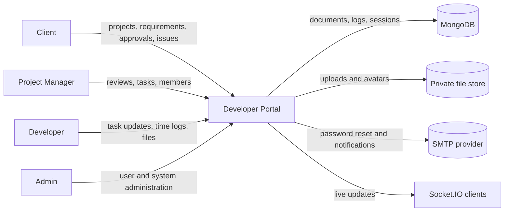
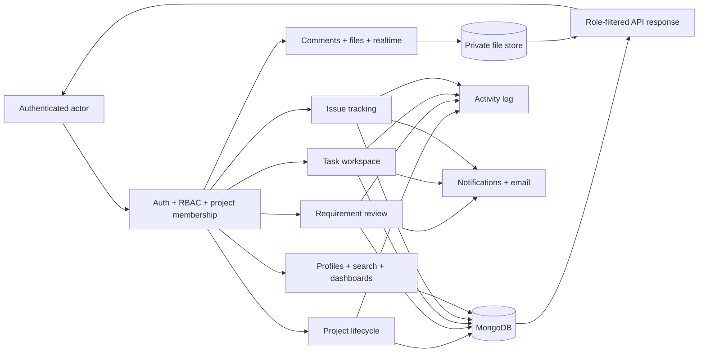
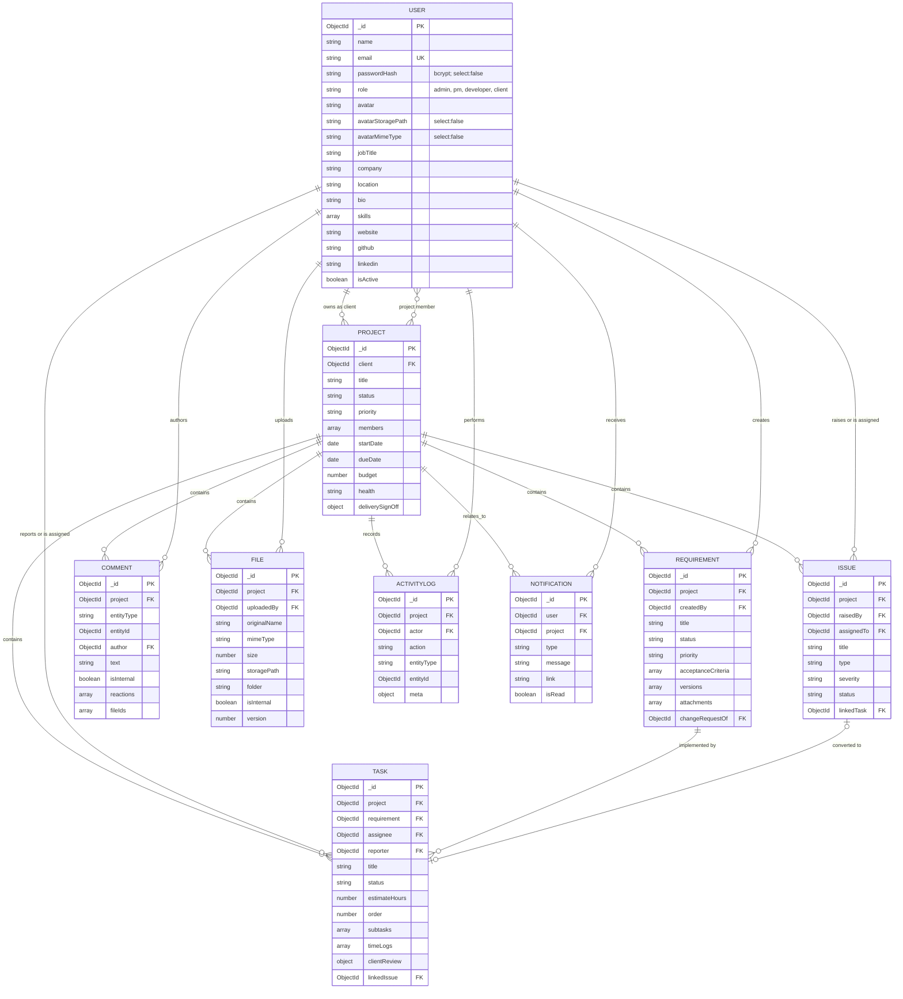
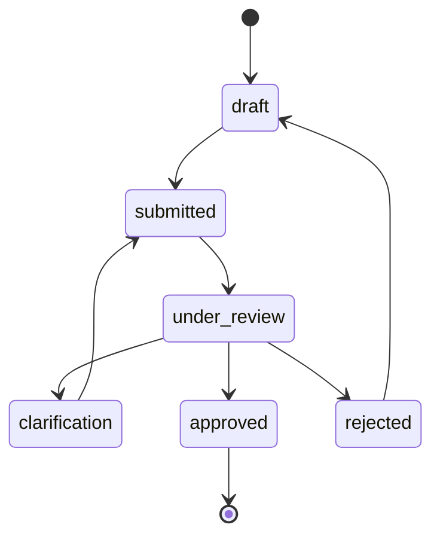
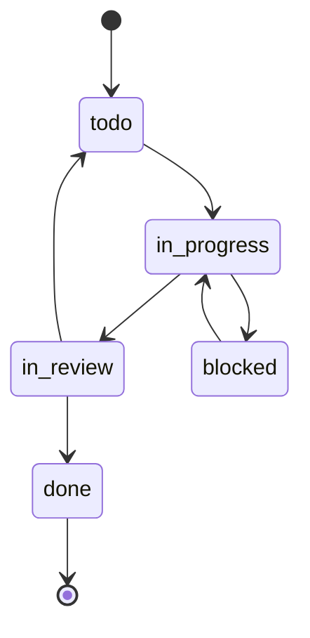
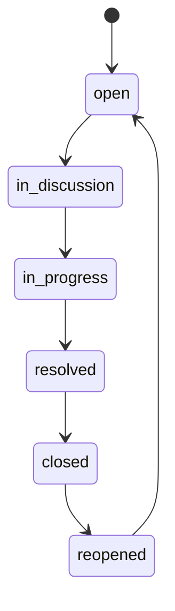

# Client-Developer Communication & Project Management Platform

## Overview

This platform manages the full delivery conversation between a client and a software
team. A client creates a project, submits requirements, follows task progress, raises
issues, discusses changes in comments, exchanges files and signs off on delivery. The
delivery team reviews requirements, creates and assigns tasks, updates status, logs time
and publishes deliverables.

The repository contains two applications:

```
backend/    Node.js + Express + TypeScript + Mongoose REST/Socket.IO API
frontend/   Angular standalone SPA
```

Access is role-based (`admin`, `pm`, `developer`, `client`). Permissions are enforced on
the backend; Angular guards and a role directive mirror them in the UI. Clients only see
their own projects, and internal comments/files are never returned to clients.

## Features

- Authentication with 15-minute JWT access tokens and 7-day httpOnly refresh cookies,
  password reset by email, profile settings and notification preferences.
- Developer profiles with uploaded PNG/JPEG pictures or any `http(s)` image URL, job
  title, company, location, skills, bio, website, GitHub and LinkedIn links; any
  signed-in user can view another member's public profile from the project team list and
  click the picture to open a full-size viewer.
- Project lifecycle with clients, members, priorities, budgets, dates, tags, statuses,
  delivery sign-off and PDF reports.
- Requirement workflow: draft → submitted → under review → clarification/approved/rejected,
  version history, approved-scope locking and linked change requests.
- Task workspace: board, sortable list and calendar views, drag-and-drop ordering,
  assignment, priorities, due dates, labels, checklists, time logs, client review and
  global cross-project task listing.
- Issue tracking with severity/status filters, PM auto-assignment, client close/reopen,
  staff progress updates and conversion into a task.
- Communication: project/entity comments with mentions, reactions, internal notes and
  real-time updates over Socket.IO.
- File exchange: multi-file upload, folder metadata, internal/private flag, previews,
  downloads and version history. Paths stay private on the server.
- Dashboards, PM workload, issue aging, project health, search and notifications.
- Angular Material UI, lazy-loaded routes, signals, typed reactive forms, charts and a
  rich-text editor.

## Tech stack

| Layer | Technologies |
| --- | --- |
| API | Node.js, Express 4, TypeScript (strict), Mongoose/MongoDB, Zod, JWT, bcryptjs |
| Realtime | Socket.IO with membership-aware rooms |
| Files/mail/jobs | multer, private local disk storage, nodemailer, node-cron, pdfkit |
| Security | Helmet, CORS with credentials, express-rate-limit, express-mongo-sanitize, sanitize-html |
| Frontend | Angular 22 standalone components, signals, OnPush, Angular Material/CDK, RxJS, ng2-charts, TipTap, socket.io-client |
| Unit/integration tests | Jest, supertest, mongodb-memory-server, Angular CLI test builder, Vitest/jsdom |

## Prerequisites

- Node.js 22+ and npm
- MongoDB listening locally or a reachable MongoDB connection string
- Optional: an SMTP account, or use `MAIL_PROVIDER=ethereal` for a local preview inbox

## Setup

```bash
git clone <repository-url>
cd Developer-Portal

# API
cd backend
npm install
copy .env.example .env        # macOS/Linux: cp .env.example .env
npm run dev                   # http://localhost:5000

# SPA (in another terminal)
cd frontend
npm install
npm start                     # http://localhost:4200
```

The API health check is `GET http://localhost:5000/api/health`. There is no Angular
dev-server proxy: the browser calls `http://localhost:5000/api` directly and CORS allows
`CLIENT_URL` with credentials.

## Environment variables

Backend variables are validated at startup in `backend/src/config/env.ts`. Never commit
`.env`; `backend/.env.example` is the template that stays up to date.

| Variable | Required | Default | Purpose |
| --- | --- | --- | --- |
| `NODE_ENV` | No | `development` | `development`, `test` or `production` |
| `PORT` | No | `5000` | API listen port |
| `MONGO_URI` | Yes | — | MongoDB connection string |
| `JWT_SECRET` | Yes | — | Access-token signing secret (minimum 32 characters) |
| `JWT_REFRESH_SECRET` | Yes | — | Refresh-token signing secret (minimum 32 characters) |
| `CLIENT_URL` | Yes | — | Allowed browser origin for CORS |
| `TRUST_PROXY` | No | `1` | Trusted reverse-proxy hops for rate limits/secure cookies; use `0` when exposed directly |
| `MAIL_PROVIDER` | No | `smtp` | `smtp` or `ethereal` |
| `SMTP_HOST` | No | `smtp.example.com` | SMTP server host |
| `SMTP_PORT` | No | `587` | SMTP server port |
| `SMTP_USER` | No | `your-smtp-user` | SMTP username |
| `SMTP_PASS` | No | `your-smtp-password` | SMTP password |
| `SMTP_FROM` | No | `"Developer Portal" <no-reply@developer-portal.local>` | From header |
| `SEED_ADMIN_PASSWORD` | No | script default | Optional seed password override (development only) |
| `SEED_PM_PASSWORD` | No | script default | Optional seed password override (development only) |
| `SEED_DEVELOPER_PASSWORD` | No | script default | Optional seed password override (development only) |
| `SEED_CLIENT_PASSWORD` | No | script default | Optional seed password override (development only) |

Frontend URLs live in `frontend/src/environments/environment.ts` and
`environment.development.ts`:

```ts
export const environment = {
  production: false,
  apiUrl: 'http://localhost:5000/api',
  socketUrl: 'http://localhost:5000',
};
```

## Seed users

Run `npm run seed` in `backend/` to reset the development database and load demo users,
projects, requirements, tasks, version history and activity. Use `npm run seed:tasks` to
add the realistic task set without deleting existing data. Both scripts refuse to run
when `NODE_ENV=production`.

| Name | Role | Email | Password |
| --- | --- | --- | --- |
| DevPortal Admin | admin | `admin@devpor.com` | `Admin@123` |
| Chetan Pawar | pm | `chetanpawar18706@gmail.com` | `Chetan@123` |
| Raghav Shastri | developer | `raghavshastri@gmail.com` | `raghav@123` |
| Ishwari Kokankar | developer | `iswarikokankar@gmail.com` | `ishwari@123` |
| Nikhil Sury | client | `nikhilsury@gmail.com` | `nikhil@123` |

Seeded users include realistic sample work profiles (avatar URL, job title, company,
location, skills and social links). Seeded projects cover draft, submitted, active,
on-hold and completed states. Requirements cover approvals, clarification requests,
version history and a linked change request.

## Scripts

### `backend/`

| Command | Description |
| --- | --- |
| `npm run dev` | API in watch mode with `ts-node-dev` |
| `npm run build` | Compile TypeScript into `dist/` |
| `npm start` | Run the compiled API |
| `npm test` | Jest unit/integration tests |
| `npm test -- --coverage` | Tests plus coverage report in `backend/coverage/` |
| `npm run lint` | ESLint |
| `npm run seed` | Reset and seed development data |
| `npm run seed:tasks` | Add demo tasks without deleting data |

### `frontend/`

| Command | Description |
| --- | --- |
| `npm start` | Angular dev server on port 4200 |
| `npm run build` | Production build into `dist/` |
| `npm run watch` | Development build in watch mode |
| `npm test -- --watch=false` | Run unit tests once |

## Folder structure

```
Developer-Portal/
├── backend/
│   ├── src/
│   │   ├── config/        environment validation, MongoDB connection, multer
│   │   ├── controllers/   HTTP controllers
│   │   ├── jobs/          scheduled notification and project-health jobs
│   │   ├── middleware/    auth, role, project access, validation, rate limits, errors
│   │   ├── models/        Mongoose schemas
│   │   ├── routes/        Express routers mounted under /api
│   │   ├── scripts/       seed and maintenance scripts
│   │   ├── services/      business logic and DTO mapping
│   │   ├── sockets/       Socket.IO server and room authorization
│   │   ├── tests/         shared factories and database test harness
│   │   ├── types/         Express request augmentation
│   │   └── utils/         errors, responses, cookies, tokens
│   ├── uploads/           private uploaded files (not committed)
│   ├── jest.config.js
│   ├── tsconfig.jest.json    CommonJS transform config for Jest
│   ├── .env.example
│   └── package.json
├── frontend/
│   ├── src/app/
│   │   ├── core/          auth, HTTP interceptors, guards, models, services
│   │   ├── shared/        reusable components, directives, pipes, utilities
│   │   └── features/      auth, dashboard, projects, requirements, tasks, issues,
│   │                      communication, files, profile, admin
│   ├── src/environments/  API and socket URLs
│   └── package.json
├── SECURITY_REVIEW.md
├── TESTING.md             single test-case catalog and suite inventory
└── README.md
```

## API summary

All endpoints are mounted under `/api`. Success responses use
`{ "success": true, "data": ..., "message": ... }`; list responses use
`{ data, total, page, limit }` inside `data`. Errors use the same envelope with
`success: false`. Query parameters support pagination, sorting and filtering. Requests
require a Bearer access token except the public auth, health and stored-avatar routes;
the refresh cookie is sent automatically with `credentials: include`.

| Area | Endpoints |
| --- | --- |
| Health | `GET /api/health` |
| Auth | `POST /api/auth/register`, `/login`, `/refresh`, `/logout`, `/forgot-password`, `/reset-password`; `GET /api/auth/me`; `PATCH /api/auth/profile` |
| Users | `GET /api/users`, `GET /api/users/lookup`, `GET /api/users/:id/profile`, `GET /api/users/:id/avatar` (public image); `POST /api/users`; `PATCH /api/users/me`, `/api/users/me/avatar`, `/api/users/me/password`, `/api/users/:id/role`, `/api/users/:id/status` |
| Projects | `GET/POST /api/projects`, `GET/PATCH/DELETE /api/projects/:id`, `PATCH /api/projects/:id/status`, `PATCH /api/projects/:id/sign-off`, `POST/DELETE /api/projects/:id/members`, `GET /api/projects/:id/activity`, `GET /api/projects/:id/report.pdf` |
| Requirements | `GET /api/requirements`, `GET /api/projects/:id/requirements`, `POST /api/projects/:id/requirements`, `GET/PATCH /api/requirements/:id`, `PATCH /api/requirements/:id/status`, `POST /api/requirements/:id/change-request`, `GET /api/requirements/:id/progress` |
| Tasks | `GET /api/tasks`, `GET /api/projects/:id/tasks`, `POST /api/projects/:id/tasks`, `GET/PATCH/DELETE /api/tasks/:id`, `PATCH /api/tasks/:id/move`, `POST /api/tasks/:id/time-logs`, `PATCH /api/tasks/:id/subtasks`, `POST /api/tasks/:id/client-review` |
| Issues | `GET /api/issues`, `GET /api/projects/:id/issues`, `POST /api/projects/:id/issues`, `GET/PATCH /api/issues/:id`, `PATCH /api/issues/:id/status`, `POST /api/issues/:id/convert-to-task` |
| Comments | `GET /api/comments`, `GET /api/comments/global`, `POST /api/comments`, `PATCH/DELETE /api/comments/:id`, `POST /api/comments/:id/reactions` |
| Files | `GET /api/files`, `GET /api/projects/:id/files`, `POST /api/projects/:id/files`, `GET /api/files/:id/download`, `GET /api/files/:id/preview`, `POST /api/files/:id/new-version`, `DELETE /api/files/:id` |
| Dashboards/reports | `GET /api/dashboard/me`, `GET /api/dashboard/admin`, `GET /api/projects/:id/dashboard`, `GET /api/projects/:id/dashboard/pm`, `GET /api/reports` |
| Search/notifications | `GET /api/search`, `GET /api/notifications`, `GET /api/notifications/unread-count`, `PATCH /api/notifications/read-all`, `PATCH /api/notifications/:id/read` |

Role gates are applied in route middleware (`allow`, `authenticate`, `projectAccess`) and
again in services where data visibility depends on project membership. Clients never
receive `isInternal` comments/files or internal metadata.

## Role and permission matrix

The backend is the source of truth. Angular guards and `*appHasRole` only mirror these
rules in the UI.

| Role | Can do | Cannot do |
| --- | --- | --- |
| `admin` | Everything: manage users, roles, statuses, all projects, reports and settings. | Nothing is explicitly denied; use this account only for administration. |
| `pm` | Review/approve/reject requirements, create and assign tasks, update any task, manage project members, triage issues, write internal notes, upload internal files, view PM dashboards. | Sign off delivery (client only), change global user roles, see projects they are not a member of. |
| `developer` | View assigned projects, update only assigned tasks, log time, update subtasks, discuss, upload non-internal/internal staff files, view developer profiles. | Create/assign tasks, review requirements, manage members, sign off delivery, edit another user's profile. |
| `client` | Create own projects and requirements, view only own projects, approve/reject requirements and delivered tasks, raise issues, comment publicly, upload non-internal files, sign off delivery, view developer profiles. | See other clients' projects, read `isInternal` comments/files, manage members, change task assignment. |

## Data flow diagram (DFD)

### Level 0 — context



### Level 1 — major processes



## Entity relationship diagram (ER)



## Data dictionary

MongoDB collections use an `ObjectId _id` primary key. Every collection except
`ActivityLog` also stores `createdAt` and `updatedAt` timestamps; `ActivityLog` stores
only `createdAt`. Fields marked `select:false` are never returned by normal API queries.

### `users`

| Field | Type | Required / default | Description |
| --- | --- | --- | --- |
| `name` | string | required, 2–80 chars | Display name. |
| `email` | string | required, unique, lowercase | Login identifier. |
| `passwordHash` | string | required, `select:false` | bcrypt hash (12 rounds). |
| `role` | enum | required, default `client` | `admin`, `pm`, `developer`, `client`. |
| `avatar` | string/null | default `null` | Public image URL or `/api/users/:id/avatar`. |
| `avatarStoragePath` | string/null | default `null`, `select:false` | Private disk path for uploaded avatar. |
| `avatarMimeType` | string/null | default `null`, `select:false` | Stored MIME type (`image/png` or `image/jpeg`). |
| `jobTitle` | string/null | default `null` | Profile job title. |
| `company` | string/null | default `null` | Profile company. |
| `location` | string/null | default `null` | Profile location. |
| `bio` | string/null | default `null`, max 1000 | Developer biography. |
| `skills` | string[] | default `[]` | Skill chips shown on public profile. |
| `website` | string/null | default `null` | Personal website URL. |
| `github` | string/null | default `null` | GitHub handle or `http(s)` URL. |
| `linkedin` | string/null | default `null` | LinkedIn handle or `http(s)` URL. |
| `isActive` | boolean | default `true` | Deactivated users cannot authenticate. |
| `notificationPrefs` | object | default all `true` | `emailOnAssignment`, `emailOnMention`, `emailOnStatusChange`, `emailOnReminder`. |
| `theme` | enum | required, default `light` | `light` or `dark`. |
| `resetTokenHash` | string/null | default `null`, `select:false` | Hashed password-reset token. |
| `resetTokenExpires` | date/null | default `null`, `select:false` | Reset token expiry. |
| `refreshTokenHash` | string/null | default `null`, `select:false` | Hashed refresh token cookie. |

### `projects`

| Field | Type | Required / default | Description |
| --- | --- | --- | --- |
| `title` | string | required, 3–120 chars | Project name. |
| `description` | string | required, 10–5000 chars | Project brief. |
| `client` | ObjectId → `users` | required | Owning client. |
| `status` | enum | required, default `draft` | `draft`, `submitted`, `in_review`, `active`, `on_hold`, `completed`, `archived`. |
| `priority` | enum | required, default `medium` | `low`, `medium`, `high`, `critical`. |
| `members` | array | default `[]` | `{ user: ObjectId, role: UserRole }` entries. |
| `startDate` | date/null | default `null` | Planned start. |
| `dueDate` | date/null | default `null` | Planned delivery date. |
| `tags` | string[] | default `[]` | Searchable labels. |
| `budget` | number | default `0`, min 0 | Project budget. |
| `health` | enum | required, default `on_track` | `on_track`, `at_risk`, `off_track`. |
| `deliverySignOff` | object | default empty | `signedBy`, `signedAt`, `note`, `rating` (1–5), `feedback`. |

### `requirements`

| Field | Type | Required / default | Description |
| --- | --- | --- | --- |
| `project` | ObjectId → `projects` | required | Parent project. |
| `title` | string | required, 3–160 chars | Requirement title. |
| `description` | string | required, max 20 000 | Full requirement text. |
| `acceptanceCriteria` | string[] | default `[]` | Acceptance checklist. |
| `priority` | enum | required, default `should` | `must`, `should`, `could`, `wont`. |
| `type` | enum | required, default `functional` | `functional`, `non_functional`. |
| `status` | enum | required, default `draft` | `draft`, `submitted`, `under_review`, `clarification`, `approved`, `rejected`. |
| `versions` | array | default `[]` | `{ title, description, editedBy, editedAt }` history. |
| `attachments` | array | default `[]` | `{ name, url, mimeType, size, uploadedBy, uploadedAt }`. |
| `fileIds` | ObjectId[] → `files` | default `[]` | Linked project files. |
| `createdBy` | ObjectId → `users` | required | Usually the client. |
| `reviewNote` | string | default `''`, max 2000 | PM review feedback. |
| `changeRequestOf` | ObjectId/null → `requirements` | default `null` | Links a change request to an approved requirement. |

### `tasks`

| Field | Type | Required / default | Description |
| --- | --- | --- | --- |
| `project` | ObjectId → `projects` | required | Parent project. |
| `requirement` | ObjectId/null → `requirements` | default `null` | Source requirement. |
| `title` | string | required, 3–160 chars | Task title. |
| `description` | string | default `''`, max 20 000 | Task details. |
| `assignee` | ObjectId/null → `users` | default `null` | Assigned developer. |
| `reporter` | ObjectId → `users` | required | Task creator. |
| `status` | enum | required, default `todo` | `todo`, `in_progress`, `in_review`, `blocked`, `done`. |
| `priority` | enum | required, default `medium` | `low`, `medium`, `high`, `critical`. |
| `estimateHours` | number | default `0`, 0–10 000 | Original estimate. |
| `dueDate` | date/null | default `null` | Task deadline. |
| `labels` | string[] | default `[]` | Task labels. |
| `order` | number | required, default `0`, min 0 | Board/list ordering. |
| `subtasks` | array | default `[]` | `{ title, done }` checklist. |
| `timeLogs` | array | default `[]` | `{ user, hours (0.25–24), note, date }`. |
| `clientReview` | object | default pending | `{ status, note, by, at }`; status is `pending`, `approved`, or `changes_requested`. |
| `linkedIssue` | ObjectId/null → `issues` | default `null` | Issue converted into this task. |

### `issues`

| Field | Type | Required / default | Description |
| --- | --- | --- | --- |
| `project` | ObjectId → `projects` | required | Parent project. |
| `title` | string | required, 3–160 chars | Issue title. |
| `description` | string | required, 10–20 000 chars | Issue detail. |
| `type` | enum | required, default `bug` | `bug`, `question`, `change_request`, `feedback`. |
| `severity` | enum | required, default `medium` | `low`, `medium`, `high`, `critical`. |
| `status` | enum | required, default `open` | `open`, `in_discussion`, `in_progress`, `resolved`, `closed`, `reopened`. |
| `stepsToReproduce` | string | default `''`, max 10 000 | Reproduction steps. |
| `raisedBy` | ObjectId → `users` | required | Reporter. |
| `assignedTo` | ObjectId/null → `users` | default `null` | Assignee; PM auto-assigned on creation. |
| `attachments` | array | default `[]` | `{ name, url, mimeType, size }`. |
| `fileIds` | ObjectId[] → `files` | default `[]` | Linked project files. |
| `linkedTask` | ObjectId/null → `tasks` | default `null` | Task created from this issue. |

### `comments`

| Field | Type | Required / default | Description |
| --- | --- | --- | --- |
| `project` | ObjectId → `projects` | required | Parent project. |
| `entityType` | enum | required | `project`, `requirement`, `task`, `issue`. |
| `entityId` | ObjectId | required | Polymorphic target document. |
| `author` | ObjectId → `users` | required | Comment author. |
| `text` | string | required, max 10 000 | Sanitized rich-text body. |
| `mentions` | ObjectId[] → `users` | default `[]` | Mentioned users. |
| `parent` | ObjectId/null → `comments` | default `null` | Thread parent. |
| `isInternal` | boolean | default `false` | Internal staff note; hidden from clients. |
| `reactions` | array | default `[]` | `{ emoji, users[] }`. |
| `attachments` | array | default `[]` | `{ name, url, mimeType, size }`. |
| `fileIds` | ObjectId[] → `files` | default `[]` | Linked project files. |
| `editedAt` | date/null | default `null` | Last edit timestamp. |

### `files`

| Field | Type | Required / default | Description |
| --- | --- | --- | --- |
| `project` | ObjectId → `projects` | required | Parent project. |
| `name` | string | required, max 300 | Stored file name. |
| `originalName` | string | required, max 300 | Uploaded file name. |
| `mimeType` | string | required, max 120 | Must be an allowed MIME type. |
| `size` | number | required, ≤ 25 MB | File size in bytes. |
| `storagePath` | string | required, max 1000 | Private disk path. |
| `folder` | enum | required, default `other` | `requirements`, `designs`, `deliverables`, `contracts`, `other`. |
| `uploadedBy` | ObjectId → `users` | required | Uploader. |
| `isInternal` | boolean | required, default `false` | Internal file; hidden from clients. |
| `version` | number | required, default `1`, min 1 | Current version number. |
| `versions` | array | default `[]` | `{ storagePath, size, uploadedBy, uploadedAt }` history. |

### `notifications`

| Field | Type | Required / default | Description |
| --- | --- | --- | --- |
| `user` | ObjectId → `users` | required | Recipient. |
| `project` | ObjectId → `projects` | required | Related project. |
| `type` | enum | required | `task_assigned`, `mention`, `requirement_status_changed`, `issue_status_changed`, `task_client_review`, `project_status_changed`, `task_due_reminder`, `task_overdue`. |
| `message` | string | required, max 500 | Notification text. |
| `link` | string | required, max 1000 | Frontend deep link. |
| `isRead` | boolean | required, default `false` | Read state. |

### `activitylogs`

| Field | Type | Required / default | Description |
| --- | --- | --- | --- |
| `project` | ObjectId → `projects` | required | Project whose timeline this entry belongs to. |
| `actor` | ObjectId → `users` | required | User who performed the action. |
| `action` | enum | required | e.g. `project_created`, `task_status_changed`, `comment_created`, `delivery_signed_off`. |
| `entityType` | enum | required | `project`, `member`, `status`, `requirement`, `task`, `comment`, `issue`. |
| `entityId` | ObjectId/null | default `null` | Affected document. |
| `meta` | mixed | default `{}` | Additional non-sensitive context such as old/new status. |

## Workflow states

Requirements:



Tasks:



Issues:



## Test cases

The complete test-case catalog and automated suite inventory live in
[`TESTING.md`](TESTING.md). Playwright/e2e tooling is not part of this repository;
testing is limited to backend and frontend automated suites plus a documented manual
smoke test.

## Testing

Run the backend and frontend suites from their own folders:

```bash
cd backend
npm run build
npm test -- --coverage
npm audit

cd ../frontend
npm run build
npm test -- --watch=false
npm audit
```

Backend tests use `mongodb-memory-server`, so no external database is needed for them.
The full test-case catalog, automated suite inventory and manual smoke steps are in
[`TESTING.md`](TESTING.md). `SECURITY_REVIEW.md` documents the security audit,
dependency-audit results and hardening decisions.
